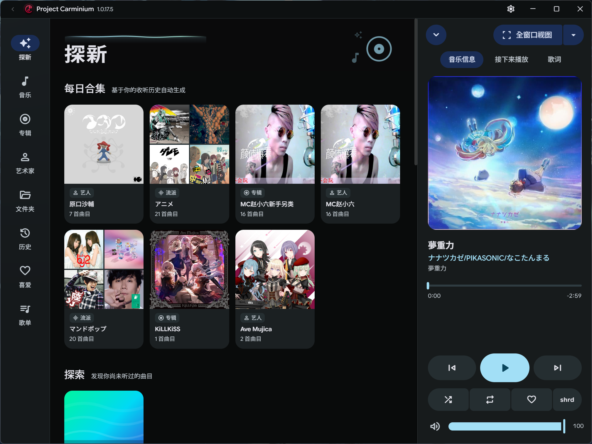
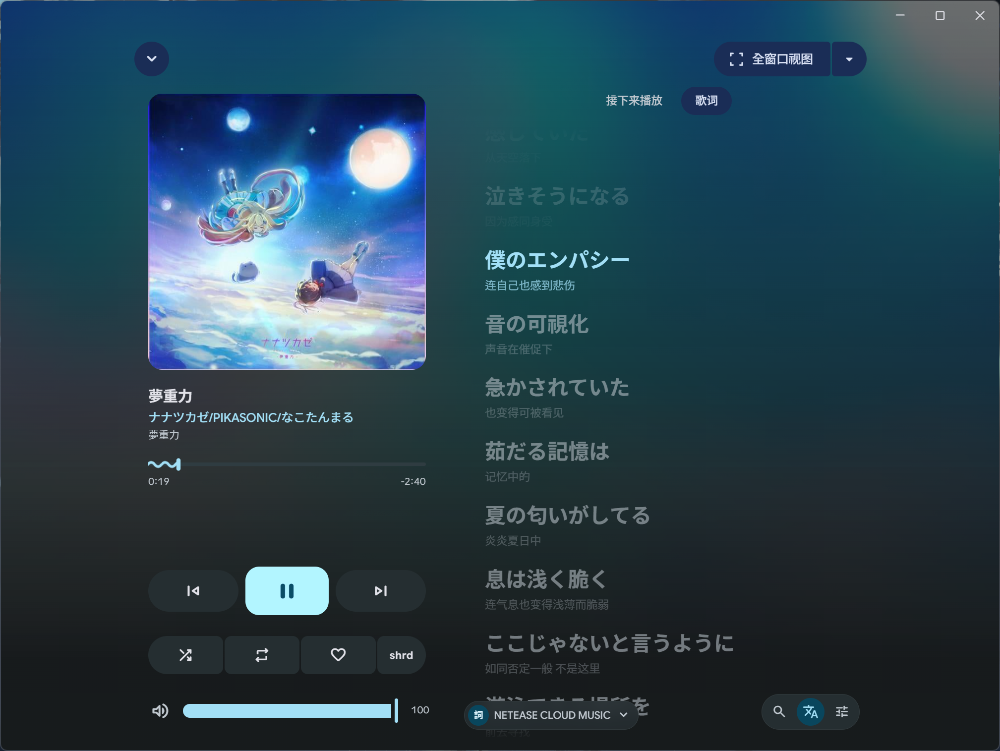
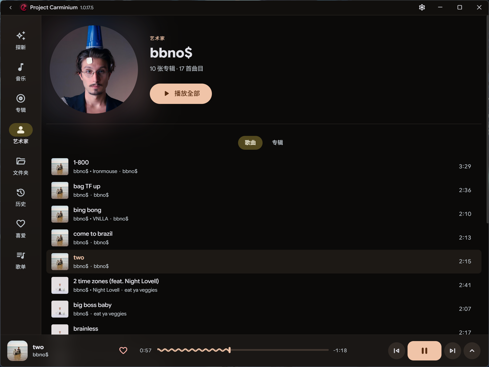
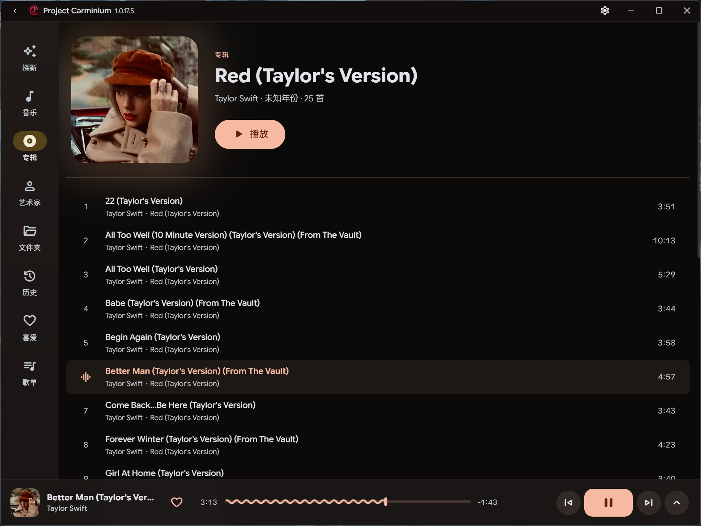

<h1>
  <picture>
    <source media="(prefers-color-scheme: dark)" srcset="build/icon-dark.png" />
    <source media="(prefers-color-scheme: light)" srcset="build/icon.png" />
    
  </picture>
  Project Carminium
</h1>

  专注于 Material You 设计的支持本地/Navidrome/WebDAV 的偏本地音乐播放器

## 概述

Project Carminium 是一款把设计和好用放在第一位的音乐播放器。本地曲库不用多说，Subsonic / OpenSubsonic、WebDAV 和 SMB 这些远程音源也统统搞得定；歌词会自动从多个在线曲库帮你匹配，要是觉得不对胃口，在正在播放页随便切换来源就行。

### 下载

- 直接去 [Release 页面](https://github.com/Seirai-Haraguchi/Project-Carminium/releases/latest) 拿最新版：Windows 便携版 `.exe`（解压就能直接用）、Linux `.deb` / `.AppImage`（x64）
- 急着尝鲜的话可以去 [Nightly 构建](https://github.com/Seirai-Haraguchi/Project-Carminium/actions/workflows/nightly.yml) 蹲每日自动构建（先说好，不太稳定哦）

### 支持播放的音乐格式

绝大多数、基本上所有格式都能播。（要是真碰上播不出来的，直接提 Issue 吧）

## 界面截图
_这些截图是 2026 年 8 月 22 日截的，跟最新的 Release 可能有点出入。_
| 探新界面 | 正在播放界面 |
|---|---|
|  |  |
| 艺人界面 | 专辑界面 |
|  |  |

## 许可证

本项目基于 [LGPL-3.0-or-later](https://www.gnu.org/licenses/lgpl-3.0.html) 许可证开源，具体细节去 [LICENSE](LICENSE) 文件里看就好。

### 鸣谢

- [miniaudio](https://github.com/mackron/miniaudio) — MIT / Public Domain
- [SoundTouch](https://gitlab.com/soundtouch/soundtouch) — LGPL-2.1
- [FFmpeg](https://ffmpeg.org/) — LGPL-2.1+ / GPL-2.0+
- [Material Design 3](https://m3.material.io/) — 设计规范（Apache 2.0）

## Star 历史

<a href="https://www.star-history.com/#stars=Seirai-Haraguchi/Project-Carminium&date=all">
<picture>
  <source media="(prefers-color-scheme: dark)" srcset="https://api.star-history.com/svg?repos=Seirai-Haraguchi/Project-Carminium&type=Date&theme=dark" />
  <source media="(prefers-color-scheme: light)" srcset="https://api.star-history.com/svg?repos=Seirai-Haraguchi/Project-Carminium&type=Date" />
  
</picture>
</a>
